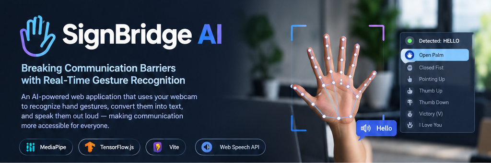

SignBridge AI 🤟
Breaking communication barriers with real-time gesture recognition
Turn hand gestures into text and speech — right in your browser.

  
  
  
  

  <a href="#-features">Features</a> ·
  <a href="#-how-it-works">How it works</a> ·
  <a href="#-get-started">Get started</a> ·
  <a href="#-custom-model-training">Model training</a> ·
  <a href="#-limitations-and-responsible-use">Limitations</a>

🌟 About the project
SignBridge AI is a browser-based hand-gesture recognition prototype built to explore how computer vision and machine learning can support more accessible communication. It uses MediaPipe to track hand landmarks, recognizes a small set of static hand poses, maps them to demo text labels, and can speak the resulting message using the browser's Web Speech API.
The app also includes an AI Training Lab for collecting labeled landmark samples and exporting them for experimentation with a custom classifier.
Project scope: SignBridge AI is a limited-vocabulary static-pose prototype—not a complete sign-language translator. Its demo labels are illustrative and are not validated translations of ASL, Indian Sign Language, or any other sign language.

✨ Features
<table>
  <tr>
    <td width="50%">
      <h3>🖐️ Real-time hand tracking</h3>
      Detects and visualizes the 21 hand landmarks through MediaPipe.
    </td>
    <td width="50%">
      <h3>🧠 Gesture recognition</h3>
      Recognizes seven built-in static poses, with support for an optional custom TensorFlow.js model.
    </td>
  </tr>
  <tr>
    <td>
      <h3>💬 Gesture-to-text</h3>
      Maps recognized poses to demo labels and lets users edit the message.
    </td>
    <td>
      <h3>🔊 Text-to-speech</h3>
      Speaks the message using the browser's Web Speech API.
    </td>
  </tr>
  <tr>
    <td>
      <h3>🧪 AI Training Lab</h3>
      Collects labeled landmark samples in the browser for model experiments.
    </td>
    <td>
      <h3>📦 Data export</h3>
      Exports collected samples as CSV/JSON for analysis and training.
    </td>
  </tr>
  <tr>
    <td>
      <h3>📈 Performance dashboard</h3>
      Shows tracking and inference timing, plus FPS information.
    </td>
    <td>
      <h3>🔐 Local-first processing</h3>
      Camera frames are processed in the browser by default and are not uploaded to a server by the app.
    </td>
  </tr>
</table>

🖐️ Built-in demo gestures
Static pose	Example output
Open Palm	HELLO
Closed Fist	STOP
Pointing Up	HELP
Thumb Up	YES
Thumb Down	NO
Victory (V)	PEACE
I Love You	I LOVE YOU

These are prototype mappings, not universal meanings. Sign languages vary by community and language, and many signs rely on motion, facial expression, body posture, and context.
⚙️ How it works
Webcam
  │
  ▼
MediaPipe hand tracking
  │
  ▼
21 hand landmarks (x, y, z)
  │
  ▼
Wrist-relative normalization
(21 × 3 = 63 features)
  │
  ▼
Built-in recognizer or optional custom model
  │
  ▼
Confidence threshold + stability filtering
  │
  ▼
Editable text message
  │
  ▼
Browser text-to-speech
Landmark preprocessing
For custom-model training, each landmark's coordinates are shifted relative to the wrist (landmark 0). The shifted coordinates are scaled by the maximum Euclidean distance from the wrist, producing 63 normalized values. Training and browser inference must use the same preprocessing.
🧰 Tech stack

  
  
  
  
  
  
  

Technology	Role
HTML, CSS, JavaScript	Web interface and application logic
Vite	Development server and production build
MediaPipe Tasks Vision	Hand landmark tracking and built-in gesture recognition
TensorFlow.js	Optional custom browser-side classifier
Web Speech API	Speech synthesis in supported browsers
Python, TensorFlow/Keras	Custom static-pose model training and evaluation

🚀 Get started
Prerequisites
- Node.js 18 or newer
- npm
- A webcam
- A modern browser with camera and speech-synthesis support
1. Clone the repository
Replace YOUR-USERNAME with your GitHub username:
git clone https://github.com/harvir011/SignBridgeAI.git
cd SignBridge
2. Install dependencies
npm install
3. Start the development server
npm run dev
Open the localhost URL printed by Vite (typically http://localhost:5173) and allow camera access.
4. Create a production build
npm run build
To preview the production build locally:
npm run preview
Important: Open the app using localhost or HTTPS rather than opening index.html directly with a file:// URL. The app copies MediaPipe WASM assets from its installed package during the predev and prebuild scripts. Hosted MediaPipe model assets may require an internet connection.
🧪 Custom model training
The repository includes a Python training pipeline for experimenting with a custom static-pose classifier.
1. Launch the app and open AI Training Lab.
2. Collect diverse, correctly labeled examples for each intended pose.
3. Export the samples as JSON.
4. Save the exported file as datasets/landmarks.json.
5. Create a Python environment and install the training requirements.
Windows PowerShell
python -m venv .venv
.\.venv\Scripts\Activate.ps1
pip install -r training/requirements.txt
python training/train_classifier.py --data datasets/landmarks.json
macOS / Linux
python3 -m venv .venv
source .venv/bin/activate
pip install -r training/requirements.txt
python training/train_classifier.py --data datasets/landmarks.json
The script writes a trained Keras model, metadata, training history, classification report, and confusion matrix to training/output/. For TensorFlow.js conversion and loading instructions, see [`training/README.md`](training/README.md).
Training recommendations
- Capture examples across multiple sessions, hand positions, and lighting conditions.
- Keep labels consistent with the sign vocabulary you intend to study.
- Prefer participant- or session-level evaluation splits to reduce data leakage.
- Treat small-dataset results as preliminary; do not present them as general sign-language accuracy.
📁 Project structure
SignBridge/
├── index.html
├── public/
│   ├── mediapipe/
│   └── models/
├── src/
│   ├── main.js
│   └── style.css
├── scripts/
│   └── copy-mediapipe.js
├── training/
│   ├── README.md
│   ├── requirements.txt
│   └── train_classifier.py
├── datasets/
│   └── README.md
├── docs/
│   ├── system-architecture.md
│   ├── prompt-documentation.md
│   └── evaluation.md
├── package.json
├── package-lock.json
└── README.md
Training output and collected landmark data may be generated locally and may not exist in a fresh clone.
🔒 Privacy
- Camera frames are processed in the browser by default; the app does not upload camera frames to a server.
- Training samples can remain in browser local storage until exported or cleared.
- Review exported datasets before sharing them, and obtain consent before publishing identifiable or personal samples.
⚠️ Limitations and responsible use
- The current baseline supports a limited set of static hand poses; it does not translate complete sign-language conversations.
- Sign languages have distinct vocabulary and grammar; signs may depend on movement, facial expression, body posture, and context.
- Confidence scores are not a guarantee that a prediction is correct or that an unknown gesture will be rejected.
- Results can vary with lighting, camera quality, background, hand orientation, and signer.
- Do not use this prototype as a substitute for a qualified interpreter in medical, legal, emergency, or other critical situations.
🛣️ Future improvements
- Temporal recognition for motion-based signs
- A larger, carefully validated sign vocabulary
- More evaluation across participants and recording conditions
- Multilingual text and speech options
- Improved mobile accessibility and responsive layouts
- Reproducible benchmarks and documented evaluation results
🤝 Contributing
Issues, suggestions, and pull requests are welcome. For substantial changes, open an issue first to discuss the proposed improvement. Please avoid committing private or identifiable training samples without informed consent.
📄 License
No license is specified in this repository yet.
 Add a LICENSE file before describing the project as open source, and choose a license that matches how you want others to use and distribute your work.

Built with AI, computer vision, and a goal of more inclusive communication.
SignBridge AI · More access. More inclusion. A brighter future.

